<picture>
  <source media="(prefers-color-scheme: dark)" srcset="./assets/brand/header-dark.svg">
  
</picture>

  <a href="#who-we-are">Who we are</a> &nbsp;·&nbsp;
  <a href="#what-we-build">What we build</a> &nbsp;·&nbsp;
  <a href="#how-we-work">How we work</a> &nbsp;·&nbsp;
  <a href="#stack">Stack</a> &nbsp;·&nbsp;
  <a href="#work-with-us">Work with us</a>

## Who we are

**Novotia Labs is a startup that builds AI agents for real industries.** We start from the problem, not the model. A client brings a messy, real workflow, and we build an agent that can read the situation, plan, use tools and finish the job. Then we check the result before anyone relies on it.

Our work is for people who need something that runs, not something that demos well. We combine ambitious ideas with careful engineering, so what we hand over is a working system your team can operate and maintain.

Today we are building in two fields, mechanical and medical. We are open to any industry with a real problem worth solving.

<picture>
  <source media="(prefers-color-scheme: dark)" srcset="./assets/brand/domains-dark.svg">
  
</picture>

## What we build

<picture>
  <source media="(prefers-color-scheme: dark)" srcset="./assets/brand/capabilities-dark.svg">
  
</picture>

- **Agentic AI.** Agents that plan, call tools and complete multi-step tasks inside a real workflow. We design their memory, limits and checks so they can be trusted with real work.
- **Mobile and Web3.** Android, iOS and on-chain products that feel simple to use. Native where it matters, cross-platform where it saves time, and verifiable where trust matters.
- **Software systems.** Backends, APIs and cloud foundations that carry the agents and apps above. Built to stay maintainable as the product and the team grow.

**What you get from us**

- A working system you can run, not a demo.
- Clear limits on what the agent does alone and where a person signs off.
- Code and documentation your own engineers can pick up.

## How we work

<picture>
  <source media="(prefers-color-scheme: dark)" srcset="./assets/brand/loop-dark.svg">
  
</picture>

Every agent we build follows the same loop.

- **Sense.** It reads real data from your systems, not a cleaned-up sample.
- **Reason.** It plans the next step and chooses the right tool for it.
- **Act.** It does the work: calls the API, fills the form, runs the calculation.
- **Verify.** It checks each result against the task before anything ships. Anything uncertain goes to a person.

**Our principles**

- Solve the actual problem before choosing the technology.
- Build with clarity, precision and purpose.
- Design for maintainability, reliability and growth.
- Explore new technology when it creates real value.
- Turn ambitious ideas into useful, real-world products.

## Stack

<picture>
  <source media="(prefers-color-scheme: dark)" srcset="./assets/brand/stack-dark.svg">
  
</picture>

## Selected work

<a href="https://github.com/NovotiaGng/MeshMend"><picture>
  <source media="(prefers-color-scheme: dark)" srcset="./assets/brand/repo-meshmend-dark.svg">
  
</picture></a>
<a href="https://github.com/NovotiaGng/NovotiaGng"><picture>
  <source media="(prefers-color-scheme: dark)" srcset="./assets/brand/repo-novotiagng-dark.svg">
  
</picture></a>

More of our code is on [GitHub](https://github.com/NovotiaGng?tab=repositories).

## Work with us

<a href="mailto:novotiaproducts@gmail.com">
<picture>
  <source media="(prefers-color-scheme: dark)" srcset="./assets/brand/cta-dark.svg">
  
</picture>
</a>

  <a href="https://github.com/NovotiaGng">GitHub</a> &nbsp;·&nbsp;
  <a href="https://www.linkedin.com/in/arnav-puggal/">LinkedIn</a> &nbsp;·&nbsp;
  <a href="https://www.instagram.com/arnavpuggal/">Instagram</a> &nbsp;·&nbsp;
  <a href="mailto:novotiaproducts@gmail.com">Email</a>

