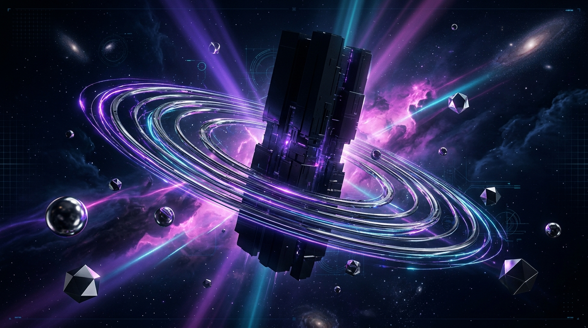
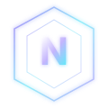

<div align="center">

<!-- ══════════════════════════════════════════════════════════════ -->
<!-- NOVOTIA LABS · PROFILE README · CINEMATIC EDITION             -->
<!-- ══════════════════════════════════════════════════════════════ -->

<!-- ▸ CINEMATIC HERO ──────────────────────────────────────────── -->



<br/>

<!-- ▸ WORDMARK ────────────────────────────────────────────────── -->


<br/>


<br/><br/>

<a href="https://github.com/NovotiaGng?tab=repositories">

</a>&nbsp;&nbsp;
<a href="mailto:novotiaproducts@gmail.com">

</a>

<br/><br/>

&nbsp;
&nbsp;
&nbsp;


<br/><br/>


</div>

<br/>


<br/>

<!-- ═══════════════════════════════════════════════════════════════ -->
<!-- § 01 — BRAND INTRODUCTION                                      -->
<!-- ═══════════════════════════════════════════════════════════════ -->

<div align="center">

### `⟡ 01` — BEYOND THE KNOWN

<br/>



<br/><br/>

**We don't follow the future. We engineer what comes next.**

</div>

<br/>

**Novotia Labs** is a technology studio exploring the intersections of decentralized systems, mobile experiences, and software engineering. We transform ambitious ideas into purposeful digital products — built with clarity, precision, and intention.

Our work spans **Web3 and blockchain architectures**, **native and cross-platform mobile applications**, and **scalable software systems** designed for real-world impact. We believe technology should do more than impress — it should solve real problems and unlock possibilities that didn't exist before.

> *Think beyond convention. Engineer with intention. Build beyond the obvious.*

<br/>


<br/>

<!-- ═══════════════════════════════════════════════════════════════ -->
<!-- § 02 — CAPABILITIES                                            -->
<!-- ═══════════════════════════════════════════════════════════════ -->

<div align="center">

### `⟡ 02` — OUR DIMENSIONS

*Three domains. One relentless engineering mindset.*

</div>

<br/>

<table>
<tr>
<td width="33%" valign="top" align="center">

<br/>

```
◈ DIMENSION 01
```

#### Web3 & Blockchain

Decentralized architectures and blockchain-powered applications exploring new models of digital ownership, connectivity, and trust.

<sub>DECENTRALIZED APPS · SMART CONTRACTS · ON-CHAIN SYSTEMS · WEB3 EXPERIENCES</sub>

<br/>

</td>
<td width="33%" valign="top" align="center">

<br/>

```
◈ DIMENSION 02
```

#### Mobile Experiences

Thoughtfully engineered mobile products that make technology more intuitive, accessible, and useful in everyday life.

<sub>ANDROID · iOS · CROSS-PLATFORM · NATIVE PERFORMANCE</sub>

<br/>

</td>
<td width="33%" valign="top" align="center">

<br/>

```
◈ DIMENSION 03
```

#### Software Systems

Purpose-built software that turns complex business challenges into practical, maintainable, and scalable digital solutions.

<sub>APPLICATION ENGINEERING · BACKEND SYSTEMS · API ARCHITECTURE · CLOUD INFRASTRUCTURE</sub>

<br/>

</td>
</tr>
</table>

<br/>


<br/>

<!-- ═══════════════════════════════════════════════════════════════ -->
<!-- § 03 — ENGINEERING PHILOSOPHY                                  -->
<!-- ═══════════════════════════════════════════════════════════════ -->

<div align="center">

### `⟡ 03` — THE ENGINEERING CODE

*Principles over hype. Substance over noise.*

</div>

<br/>

```
┌─────────────────────────────────────────────────────────────────────────┐
│                                                                         │
│   01 ▸ UNDERSTAND    Solve the actual problem before selecting          │
│                      the technology.                                    │
│                                                                         │
│   02 ▸ ENGINEER      Build with clarity, precision, and purpose.        │
│                                                                         │
│   03 ▸ EVOLVE        Design for maintainability, reliability,           │
│                      and growth.                                        │
│                                                                         │
│   04 ▸ INNOVATE      Explore emerging technologies when they            │
│                      create meaningful value.                           │
│                                                                         │
│   05 ▸ DELIVER       Turn ambitious ideas into useful,                  │
│                      real-world experiences.                            │
│                                                                         │
└─────────────────────────────────────────────────────────────────────────┘
```

<br/>


<br/>

<!-- ═══════════════════════════════════════════════════════════════ -->
<!-- § 04 — TECHNOLOGY MATRIX                                       -->
<!-- ═══════════════════════════════════════════════════════════════ -->

<div align="center">

### `⟡ 04` — TECHNOLOGY MATRIX

*Our tools evolve. Our engineering mindset endures.*

<br/>

<table>
<tr>
<td align="center" width="25%">

**LANGUAGES**

<br/>


</td>
<td align="center" width="25%">

**FRONTEND & MOBILE**

<br/>


</td>
<td align="center" width="25%">

**CLOUD & INFRA**

<br/>


</td>
<td align="center" width="25%">

**DATA & BACKEND**

<br/>


</td>
</tr>
</table>

</div>

<br/>


<br/>

<!-- ═══════════════════════════════════════════════════════════════ -->
<!-- § 05 — PROJECTS                                                -->
<!-- ═══════════════════════════════════════════════════════════════ -->

<div align="center">

### `⟡ 05` — ACTIVE REPOSITORIES

*The work speaks through the code.*

<br/>

<a href="https://github.com/NovotiaGng/MeshMend">

</a>

<br/><br/>

<a href="https://github.com/NovotiaGng?tab=repositories">

</a>

</div>

<br/>


<br/>

<!-- ═══════════════════════════════════════════════════════════════ -->
<!-- § 06 — TRANSMISSION LOG                                        -->
<!-- ═══════════════════════════════════════════════════════════════ -->

<div align="center">

### `⟡ 06` — TRANSMISSION LOG

*Signal strength. Contribution frequency. Code velocity.*

<br/>

<a href="https://github.com/NovotiaGng">

</a><a href="https://github.com/NovotiaGng">

</a>

<br/><br/>


<br/><br/>

<!-- GitHub Activity Graph -->


</div>

<br/>


<br/>

<!-- ═══════════════════════════════════════════════════════════════ -->
<!-- § 07 — CONTACT                                                 -->
<!-- ═══════════════════════════════════════════════════════════════ -->

<div align="center">

### `⟡ 07` — THE NEXT FRONTIER

<br/>

**The universe is not the limit.**

Have an ambitious product idea, a complex technical challenge, or a vision worth engineering?

We welcome conversations with founders, builders, and teams ready to create something meaningful.

<br/>

<a href="mailto:novotiaproducts@gmail.com">

</a>

<br/><br/>

<a href="https://github.com/NovotiaGng">

</a>&nbsp;
<a href="https://www.linkedin.com/in/arnav-puggal/">

</a>&nbsp;
<a href="https://www.instagram.com/arnavpuggal/">

</a>&nbsp;
<a href="mailto:novotiaproducts@gmail.com">

</a>

<br/><br/>

</div>

<!-- ▸ CINEMATIC FOOTER ────────────────────────────────────────── -->


